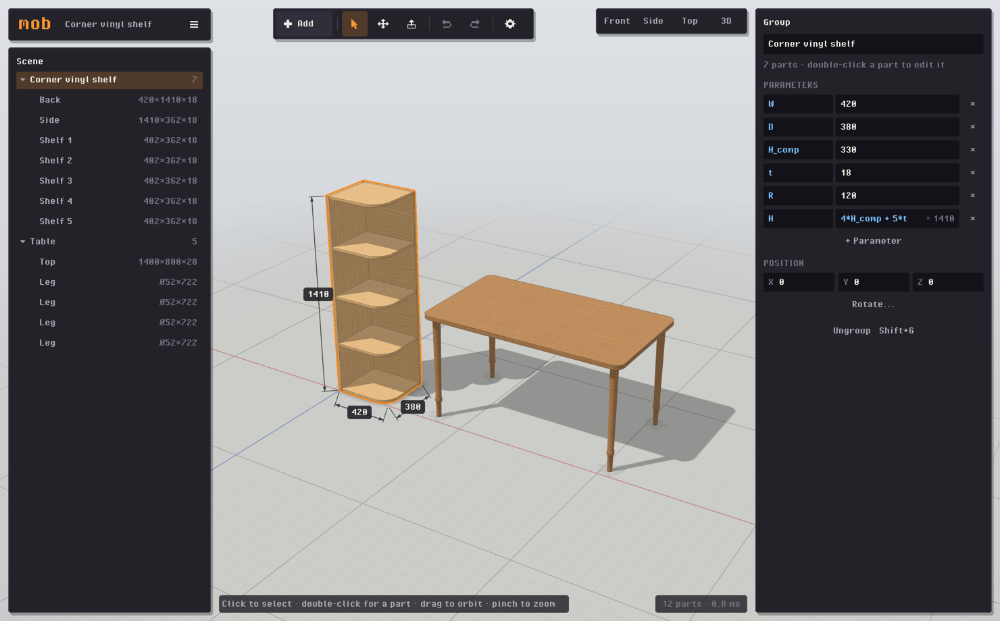
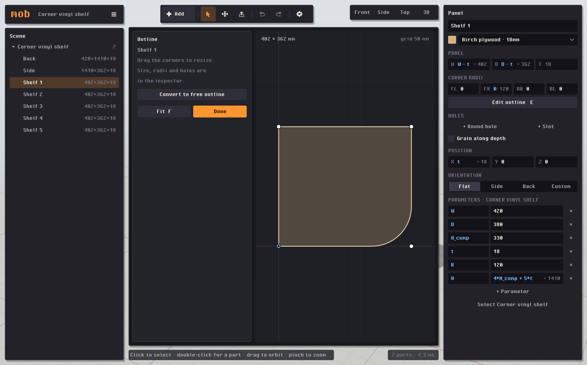
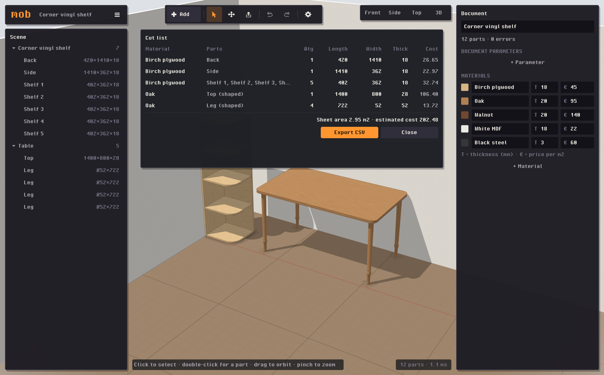
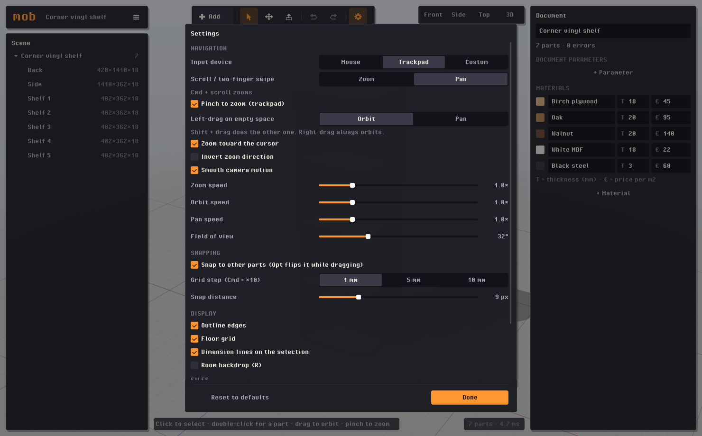

# mob

A fast, native furniture design tool written in Odin. It uses only `vendor:raylib` and `core`.



Selecting the shelf shows its parameters. Changing `H_comp` resizes every shelf and side.

```
./build.sh            # release build -> bin/mob
./build.sh debug      # debug build, reports leaks on exit
./build.sh test       # unit tests (expr, geom, model, io)
./bin/mob [file.mob]  # files can also be dropped on the window
```

On launch it reopens the last project you opened or saved (you can turn this off in Settings), or starts with an empty scene.

Dev flags: `--selftest <dir>` clicks through the UI and runs end-to-end editing checks in a live window. `--bench [n]` builds about 7·n parts and reports frame times. `--shot out.png` saves a screenshot, and you can combine it with `--select-first`, `--tool move`, `--editor`, `--cuts`, `--room`, `--settings` and `--view top`. Dev runs start from the demo shelf (`--empty` for a blank one), and they never write your settings unless you pass `--settings-file <path>`.

## Using it

- **Add** in the toolbar places a part (panel, turned, swept, also **B**, **T**, **S**) or a parametric template. The **≡** menu next to the document name holds New/Open/Save, the cut list and the exports.
- Click a piece to select its group. The inspector then shows the group's parameters, and changing one (for example `H_comp`) resizes everything. Double-click selects a single part.
- Any number field accepts an expression: `W - 2*t`, `1.8cm`, `max(a, b)`, `round(x, 5)`. Names resolve from the part's group, then parent groups, then the document. Drag a field's label to scrub its value.
- **Push/Pull (P)** resizes a panel by dragging one of its faces. If an expression drives the size, the tool edits the parameter behind it.
- **Move (M)** has arrows plus snapping to other parts' bounds. Hold ⌘ for a 10 mm grid and ⌥ to turn snapping off. Type a distance, then press Enter.
- **Settings** (gear button or ⌘,): Mouse / Trackpad presets, scroll to zoom or pan, pinch to zoom, zoom/orbit/pan speed, left-drag orbit or pan, field of view, snapping and grid step, display toggles, and the documents folder. They're saved to `~/Library/Application Support/mob/settings.json`.
- **E** opens the 2D outline, profile or path editor (fillets, holes, double-click to add a point).
- Exports: the cut list as CSV, panel outlines as 1:1 SVG (exact arcs), and OBJ. Press **K** for all shortcuts.

## Screenshots

**Outline editor.** The rounded corner is driven by the `R` parameter. Size, radii and holes stay editable in the inspector.



**Cut list and room backdrop.** Identical parts are grouped, and shaped parts are marked.



**Settings.** Mouse and trackpad presets (pinch to zoom), speeds, snapping and display options.



## Layout

`src/expr` (Pratt parser) · `src/geom` (profiles, fillets, triangulation, extrude/lathe/sweep, raycast) · `src/model` (document, scope chain evaluation, param solving, templates) · `src/io` (JSON, CSV, SVG, OBJ) · `src/render` (shaders, mesh cache, shadows, outline) · `src/ui` (immediate-mode widgets) · `src/app` (tools, inspector, editor, undo).

## Fonts

The UI uses Pixel Operator Bold (CC0, `assets/fonts`) at 16 pt. At that size each font pixel is exactly one point, so text renders as sharp pixels.
